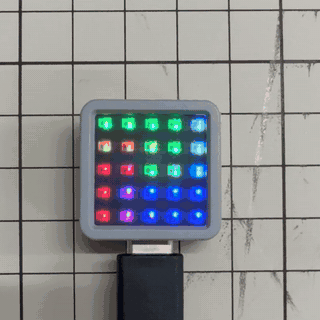
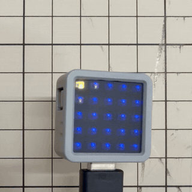
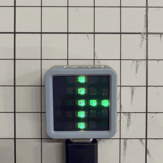
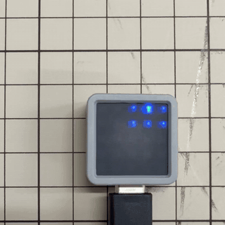
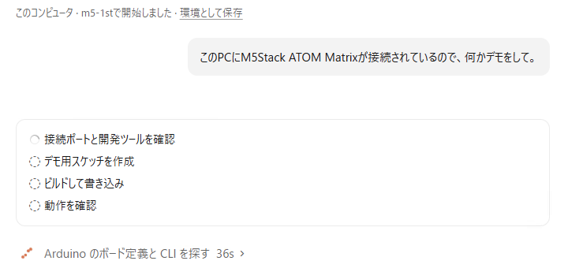
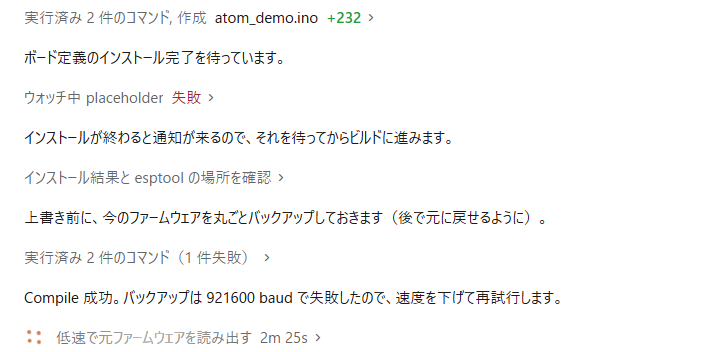

# M5Stack ATOM Matrix Demo

[日本語](README.md) | English

A demo for the M5Stack ATOM Matrix (5×5 full-color LEDs, a button, and a tilt sensor).
We asked Claude in the Code tab of the Claude desktop app to "run some demo" on the connected device, and Claude wrote the program and flashed it.

## Demo in action

| Rainbow | Bubble level | Text scroll | Sparkle |
|---|---|---|---|
|  |  |  |  |

The "bubble level" mode was originally built as a "tilt ball". See [Reframing a bug: from rolling ball to bubble level](#reframing-a-bug-from-rolling-ball-to-bubble-level) for the story.

## The 4 modes

Press the LED face to switch to the next mode.

| # | Mode | What it does |
|---|---|---|
| 0 | Rainbow | Rainbow colors swirl out from the center |
| 1 | Bubble level | Tilt the device and the dot of light moves toward the raised side, like the bubble in a spirit level (uses the built-in MPU6886 IMU; originally built as a "tilt ball") |
| 2 | Text scroll | "HELLO ATOM M5!" scrolls by, changing color |
| 3 | Sparkle | Lights burst at random spots and fade out |

LED brightness is set to 20/255 to keep the device from getting hot.

## How it went in Claude

We used the Code tab of the Claude desktop app (Pro plan), and it took about 30 minutes. All the human typed was one short sentence and a few "Allow" clicks.
(The screenshots show the Japanese UI, cropped to the conversation area only.)

### 1. Ask in one sentence

We chose a working folder and typed just this one sentence. No detailed steps were given.


> このPCにM5Stack ATOM Matrixが接続されているので、何かデモをして。
>
> *"An M5Stack ATOM Matrix is connected to this PC, so please run some kind of demo."*

### 2. Claude makes a plan

Claude decided on 4 stages by itself (check → build → flash → verify) and started looking up which port the device was on (COM3) and what tools were available.



### 3. It asks before anything important

Before overwriting the device's program or downloading tools (with the download size shown), it always asks first. If you are unsure, you can use "Plan mode" to review the plan before anything runs.


### 4. Then just wait

It installed the tools, backed up the original firmware, and compiled, in that order. When the backup failed, it lowered the speed and retried on its own. The human did nothing during this time.



### 5. A report and a request to check

After flashing and confirming startup, it explained how to use the demo and how to restore the original firmware. Claude cannot see the LEDs, so it asked the human to check how they looked.


### 6. Describe what you saw and let it fix things

We told it "which way I tilted it and which way the light moved". Claude checked the cause with the sensor readings (logs) before making a fix.


### Who did what

| Claude | Human |
|---|---|
| Looked up the connected device and tools | Said what they wanted in one sentence |
| Found and installed missing tools | Allowed the overwrite and the downloads |
| Wrote and fixed the program | Watched the LEDs and reported what they saw |
| Flashed the device and checked the boot log | Decided when it was "good enough" |
| Made a backup so it could be restored | Found a new way to use an unexpected result |

### Reframing a bug: from rolling ball to bubble level

Claude first built a mode where "tilting the device makes a ball roll toward the lower side".

| Round | What happened | Who acted |
|---|---|---|
| 1st try | Rolled correctly along the USB direction, but backwards in the perpendicular direction | Human checked the device and reported |
| Fix | Read the sensor values and flipped only the axis that seemed reversed | Claude |
| 2nd try | Now all 4 directions were backwards: the dot moved toward the raised side | Human checked the device and reported |
| Outcome | "If you think of it as the bubble in a spirit level, this is exactly right" — reframed and called it done | **Human** |

Claude was only aiming to "fix it so the ball rolls as specified". The human noticed that "moving toward the raised side" is exactly how a spirit-level bubble behaves, and turned the failure into a different kind of toy. That is why this mode was renamed from "tilt ball" to "bubble level".

**What we learned**
- **AI can get it wrong too**: The job isn't done until it is checked on the real device. Claude cannot see the LEDs, so checking is the human's role
- **Specific feedback leads to the next step**: Telling it "which way I tilted it and how it moved" made it possible to narrow down the cause
- **A change of perspective starts with the human**: Claude works toward the goal it was given. Stepping back from that goal and deciding "this is good as it is" is up to the human. Whether to fix it or keep it is the human's call

### Tips for first-time users

1. **A rough request is fine**: Even "run some demo" works; Claude investigates the situation first and then proposes something
2. **It asks before important steps**: You'll be asked before anything is overwritten or downloaded
3. **Give specific feedback**: Writing "I did this, and that happened" helps it narrow down the cause
4. **You can pick up where you left off**: The program, the backup, and notes (memory) remain, so later fixes can continue from there

## Pins

| Part | Pin |
|---|---|
| LEDs (WS2812 × 25) | GPIO27 |
| Button | GPIO39 |
| IMU (MPU6886) | I2C SDA=GPIO25 / SCL=GPIO21 |

## Steps (Windows)

### 1. Install the tools

Install [arduino-cli](https://github.com/arduino/arduino-cli/releases), then the ESP32 board package and the NeoPixel library.

```bash
arduino-cli core update-index --additional-urls https://espressif.github.io/arduino-esp32/package_esp32_index.json
arduino-cli core install esp32:esp32 --additional-urls https://espressif.github.io/arduino-esp32/package_esp32_index.json
arduino-cli lib install "Adafruit NeoPixel"
```

Tested with arduino-cli 1.6.0 and esp32:esp32 3.3.12.

### 2. Back up the original firmware (optional, recommended)

Flashing overwrites the original program. Reading the whole flash first lets you restore it later.
esptool is installed together with the ESP32 board package (`%LOCALAPPDATA%\Arduino15\packages\esp32\tools\esptool_py\<version>\esptool.exe`).

```bash
esptool --port COM3 --baud 115200 read-flash 0 ALL backup_original_firmware.bin
```

Reading 4MB takes about 7 minutes. It failed partway at 921600 baud, so 115200 baud is used.

### 3. Build and flash

Replace `COM3` with your own port (see "Ports (COM & LPT)" in Device Manager).

```bash
arduino-cli compile --upload -p COM3 --fqbn esp32:esp32:m5stack_atom:UploadSpeed=115200 atom_demo
```

### 4. Check that it works

If the serial monitor (115200 baud) shows the following, it has started.

```
IMU WHO_AM_I = 0x19
ATOM Matrix demo start. IMU: OK
Mode 0: Rainbow
```

In the bubble level mode, the acceleration (x, y, z) is printed once per second.

### 5. Restore the original firmware

```bash
esptool --port COM3 --baud 115200 write-flash 0 backup_original_firmware.bin
```

## Note: if you want a rolling ball instead

To get the original "tilt ball" (rolling toward the lower side) instead of the bubble, flip the signs of both the x and y axes in `modeTilt()` (`velX ... + ax`, `velY ... + ay`) and check on the real device.
