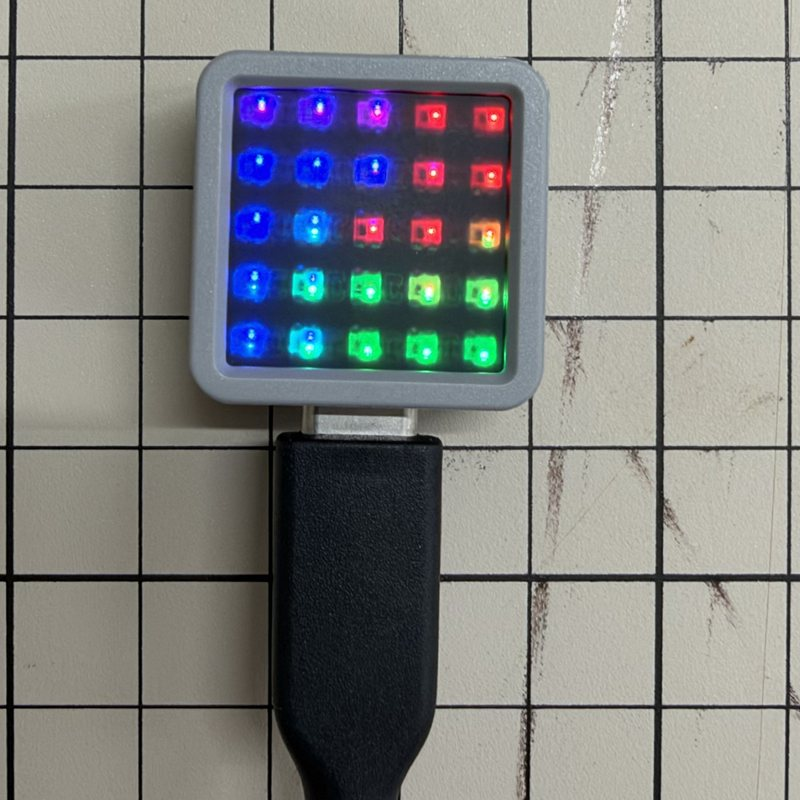

# M5Stack ATOM Matrix デモ

M5Stack ATOM Matrix（5×5 フルカラー LED、ボタン、傾きセンサー付き）で動くデモです。
デスクトップ版 Claude の Code タブに「このPCにM5Stack ATOM Matrixが接続されているので、何かデモをして。」と頼み、Claude が作って書き込みました。

## 動作の様子

| レインボー | 傾きボール | 文字スクロール | 花火 |
|---|---|---|---|
| （ここに写真） | （ここに写真） | （ここに写真） | （ここに写真） |

**動画**: （ここに動画）

<!--
写真・動画の追加方法:
1. ファイルを media/ フォルダに入れる（例: media/rainbow.jpg、media/demo.mp4）
2. 上の「（ここに写真）」を  のように書き換える
3. 動画は GitHub の Web 画面でこの README を編集し、mp4 をドラッグ＆ドロップすると再生できる形で埋め込まれる
   （リポジトリに入れる場合は 1 ファイル 100MB 未満、できれば 10MB 程度まで。短い GIF なら  でそのまま動く）
-->

## 4つのモード

LED の面を押すたびに、次のモードに切り替わります。

| # | モード | 内容 |
|---|---|---|
| 0 | レインボー | 中心から虹色が渦を巻いて回る |
| 1 | 傾きボール | 本体を傾けるとボールが転がり、壁で跳ね返る（内蔵 IMU MPU6886 を使用） |
| 2 | 文字スクロール | 「HELLO ATOM M5!」が色を変えながら流れる |
| 3 | 花火 | ランダムな位置で光がはじけて消える |

発熱を抑えるため、LED の明るさは 20/255 にしています。

## 使うピン

| 部品 | ピン |
|---|---|
| LED（WS2812 × 25） | GPIO27 |
| ボタン | GPIO39 |
| IMU（MPU6886） | I2C SDA=GPIO25 / SCL=GPIO21 |

## 手順（Windows）

### 1. 道具を入れる

[arduino-cli](https://github.com/arduino/arduino-cli/releases) を入れたあと、ESP32 のボード定義と NeoPixel ライブラリを入れます。

```bash
arduino-cli core update-index --additional-urls https://espressif.github.io/arduino-esp32/package_esp32_index.json
arduino-cli core install esp32:esp32 --additional-urls https://espressif.github.io/arduino-esp32/package_esp32_index.json
arduino-cli lib install "Adafruit NeoPixel"
```

動作を確かめた版: arduino-cli 1.6.0、esp32:esp32 3.3.12。

### 2. 元のファームウェアを保存する（任意・おすすめ）

書き込むと元のプログラムは上書きされます。先に丸ごと読み出しておくと、あとで戻せます。
esptool は ESP32 のボード定義と一緒に入ります（`%LOCALAPPDATA%\Arduino15\packages\esp32\tools\esptool_py\<版>\esptool.exe`）。

```bash
esptool --port COM3 --baud 115200 read-flash 0 ALL backup_original_firmware.bin
```

4MB の読み出しに約7分かかります。921600 baud では途中で失敗したため、115200 baud を使っています。

### 3. ビルドして書き込む

`COM3` は自分の環境のポート番号に変えてください（デバイスマネージャーの「ポート (COM と LPT)」で分かります）。

```bash
arduino-cli compile --upload -p COM3 --fqbn esp32:esp32:m5stack_atom:UploadSpeed=115200 atom_demo
```

### 4. 動作を確かめる

シリアルモニター（115200 baud）に次のように出れば起動しています。

```
IMU WHO_AM_I = 0x19
ATOM Matrix demo start. IMU: OK
Mode 0: Rainbow
```

傾きボールのモードでは、1秒ごとに加速度（x, y, z）が出ます。

### 5. 元のファームウェアに戻す

```bash
esptool --port COM3 --baud 115200 write-flash 0 backup_original_firmware.bin
```

## 分かっている問題

- **傾きボールが4方向とも逆に動く**: 傾けて持ち上がった側へ動くので、今は「気泡」として扱っています。直すときは `modeTilt()` で x 軸・y 軸の両方の符号を反転させ（`velX ... + ax`、`velY ... + ay`）、実機で確かめます。
