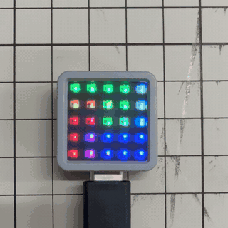
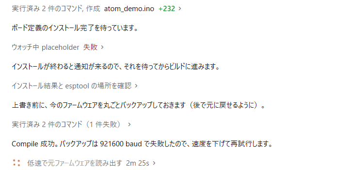
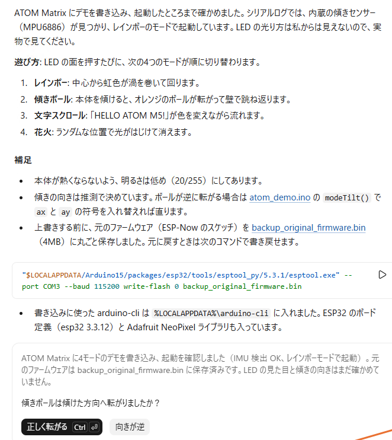

# M5Stack ATOM Matrix デモ

M5Stack ATOM Matrix（5×5 フルカラー LED、ボタン、傾きセンサー付き）で動くデモです。
デスクトップ版 Claude の Code タブに「このPCにM5Stack ATOM Matrixが接続されているので、何かデモをして。」と頼み、Claude が作って書き込みました。

## 動作の様子

| レインボー | 気泡（水準器） | 文字スクロール | 花火 |
|---|---|---|---|
|  |  |  |  |

「気泡」のモードは、もともと「傾きボール」として作ったものです。いきさつは「[ボールが逆に転がった → 気泡として読み替えた](#ボールが逆に転がった--気泡として読み替えた)」をご覧ください。

<!--
GIF の作り方:
1. 撮影した元ファイルは media_raw/ に置く（位置情報を含むので .gitignore で除外している）
2. 位置情報と音声を外し、4本とも同じ切り抜き・大きさで GIF にする
   ffmpeg -t 5 -i IN.mov -an -map_metadata -1 -vf "crop=iw*0.75:iw*0.75:iw*0.125:ih*0.24,fps=10,scale=320:320:flags=lanczos,split[a][b];[a]palettegen=max_colors=128:stats_mode=diff[p];[b][p]paletteuse=dither=bayer:bayer_scale=4:diff_mode=rectangle" OUT.gif
3. README から  のように参照する
-->

## 4つのモード

LED の面を押すたびに、次のモードに切り替わります。

| # | モード | 内容 |
|---|---|---|
| 0 | レインボー | 中心から虹色が渦を巻いて回る |
| 1 | 気泡（水準器） | 本体を傾けると、光の玉が持ち上がった側へ動く。水準器の気泡と同じ動き（内蔵 IMU MPU6886 を使用。もとは「傾きボール」として作ったもの） |
| 2 | 文字スクロール | 「HELLO ATOM M5!」が色を変えながら流れる |
| 3 | 花火 | ランダムな位置で光がはじけて消える |

発熱を抑えるため、LED の明るさは 20/255 にしています。

## Claude での操作の流れ

デスクトップ版 Claude の Code タブ（Pro プラン）で、約30分かかりました。人が入力したのは短い文と「許可」だけです。
（画面は会話の部分だけを切り抜いています）

### 1. 一文で頼む

作業用のフォルダを選び、次の一文を入力しただけです。細かい手順は伝えていません。


### 2. Claude が計画を立てる

Claude は「確認 → 作成 → 書き込み → 動作確認」の4段階を自分で決め、つながっている場所（COM3）や使える道具を調べ始めます。


### 3. 大事な操作の前に許可を求めてくる

本体のプログラムの上書きや、道具のダウンロード（容量も書いてある）の前に、必ず確認があります。不安なら「プランモード」で、計画を見てから進めることもできます。


### 4. あとは待つだけ

道具の導入、元のプログラムのバックアップ、コンパイルを順に進めます。バックアップが失敗したときは、自分で速度を下げてやり直しました。この間、人は何もしていません。



### 5. 結果の報告と確認の依頼

書き込みと起動の確認が済むと、遊び方や元に戻す方法まで説明してくれます。Claude には LED が見えないので、見た目は人に確かめるよう頼んできます。



### 6. 実物の様子を伝えて直してもらう

「どの向きに傾けたら、どう動いたか」を伝えると、Claude はセンサーの値（ログ）で原因を確かめてから直します。


### 役割分担

| Claude がしたこと | 人がしたこと |
|---|---|
| つながっている機器と道具を調べる | やりたいことを一文で伝える |
| 足りない道具を探して入れる | 上書きとダウンロードを許可する |
| プログラムを書く、直す | LED の光り方や動きを目で見て伝える |
| 本体へ書き込み、起動ログで確認 | どこまでで「良し」とするか決める |
| 元に戻せるようバックアップを取る | 思いどおりでない結果を、別の見方で生かす |

### ボールが逆に転がった → 気泡として読み替えた

Claude は最初、「傾けると、下になった側へボールが転がる」モードを作りました。

| 回 | 起きたこと | 誰が動いたか |
|---|---|---|
| 1回目 | USB の向きは正しく転がるが、直角の向きだけ逆 | 人が実物を見て伝える |
| 対応 | センサーの値を読み、逆になっている軸だけ向きを反転 | Claude |
| 2回目 | 今度は4方向とも逆。光の玉は、持ち上がった側へ動くようになった | 人が実物を見て伝える |
| 決着 | 「水準器の気泡だと思えば、これで正しい動き」と読み替え、完成とした | **人** |

Claude は「仕様どおりボールが転がるように直す」ことだけを目指していました。それに対して人は、「持ち上がった側へ動く」のは水準器の気泡と同じ動きだと気づき、失敗を別の遊びとして生かしました。このモードの名前を「傾きボール」から「気泡（水準器）」に変えたのは、そのためです。

**学んだこと**
- **AI の判断も外れることがある**: 実物で確かめるまでが一区切り。Claude には LED が見えないので、確かめるのは人の役目
- **具体的に返すと次の一手が決まる**: 「どの向きに傾けたら、どう動いたか」を伝えたことで、原因をしぼり込めた
- **発想の転換は人が起点になる**: Claude は与えられた目標に向けて直そうとする。目標そのものを見直して「これはこれで良い」と決められるのは人。直すか、生かすかは人が決めてよい

### はじめて使う人へのコツ

1. **ざっくり頼んでいい**: 「何かデモをして」でも、Claude が状況を調べてから提案してくれる
2. **大事な操作は聞いてくる**: 上書きやダウンロードの前に確認がある
3. **結果は具体的に返す**: 「どうしたら、どうなったか」を書くと、原因をしぼり込める
4. **続きから再開できる**: プログラム・バックアップ・覚え書き（メモリ）が残るので、後日の修正も続きから

## 使うピン

| 部品 | ピン |
|---|---|
| LED（WS2812 × 25） | GPIO27 |
| ボタン | GPIO39 |
| IMU（MPU6886） | I2C SDA=GPIO25 / SCL=GPIO21 |

## 手順（Windows）

### 1. 道具を入れる

[arduino-cli](https://github.com/arduino/arduino-cli/releases) を入れたあと、ESP32 のボード定義と NeoPixel ライブラリを入れます。

```bash
arduino-cli core update-index --additional-urls https://espressif.github.io/arduino-esp32/package_esp32_index.json
arduino-cli core install esp32:esp32 --additional-urls https://espressif.github.io/arduino-esp32/package_esp32_index.json
arduino-cli lib install "Adafruit NeoPixel"
```

動作を確かめた版: arduino-cli 1.6.0、esp32:esp32 3.3.12。

### 2. 元のファームウェアを保存する（任意・おすすめ）

書き込むと元のプログラムは上書きされます。先に丸ごと読み出しておくと、あとで戻せます。
esptool は ESP32 のボード定義と一緒に入ります（`%LOCALAPPDATA%\Arduino15\packages\esp32\tools\esptool_py\<版>\esptool.exe`）。

```bash
esptool --port COM3 --baud 115200 read-flash 0 ALL backup_original_firmware.bin
```

4MB の読み出しに約7分かかります。921600 baud では途中で失敗したため、115200 baud を使っています。

### 3. ビルドして書き込む

`COM3` は自分の環境のポート番号に変えてください（デバイスマネージャーの「ポート (COM と LPT)」で分かります）。

```bash
arduino-cli compile --upload -p COM3 --fqbn esp32:esp32:m5stack_atom:UploadSpeed=115200 atom_demo
```

### 4. 動作を確かめる

シリアルモニター（115200 baud）に次のように出れば起動しています。

```
IMU WHO_AM_I = 0x19
ATOM Matrix demo start. IMU: OK
Mode 0: Rainbow
```

気泡のモードでは、1秒ごとに加速度（x, y, z）が出ます。

### 5. 元のファームウェアに戻す

```bash
esptool --port COM3 --baud 115200 write-flash 0 backup_original_firmware.bin
```

## メモ：ボールとして転がしたい場合

気泡ではなく、もとの「傾きボール」（下になった側へ転がる）にしたいときは、`modeTilt()` で x 軸・y 軸の両方の符号を反転させ（`velX ... + ax`、`velY ... + ay`）、実機で確かめます。
